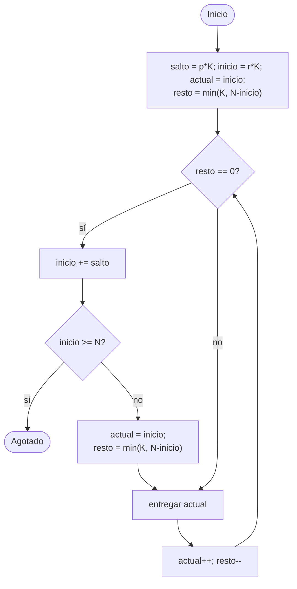
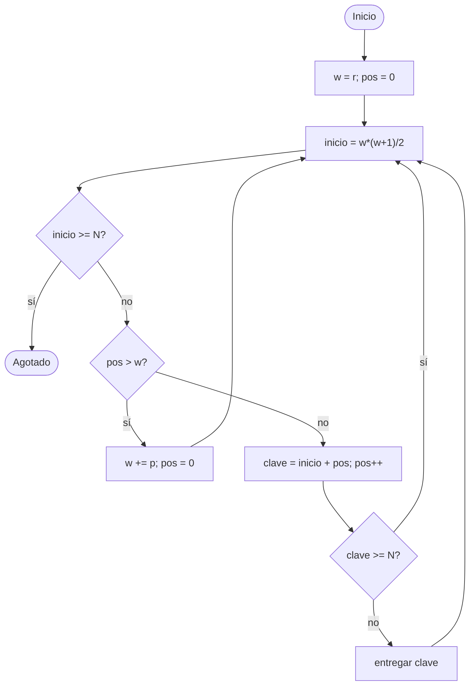
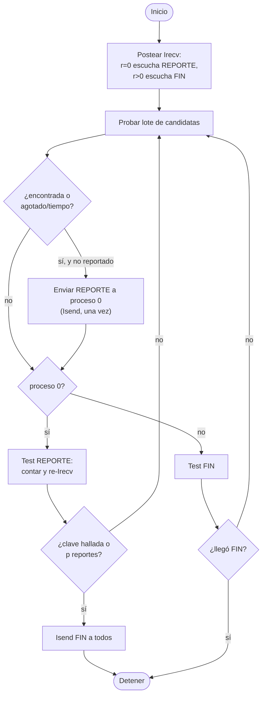
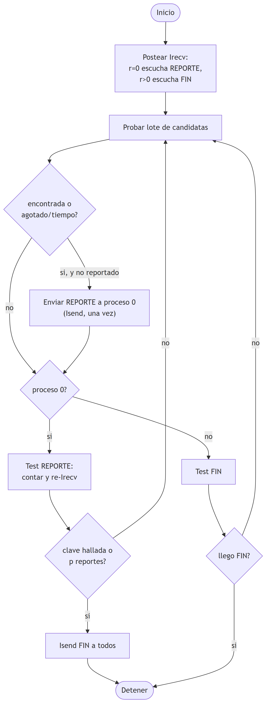

# Estrategias de distribución y terminación asíncrona (incisos 3 y 4)

Documento de Cindy. Describe el pseudocódigo y los diagramas de flujo de las
estrategias de reparto de claves implementadas en
[`busqueda_mpi.c`](../busqueda_mpi.c) y del esquema de terminación asíncrona.

Notación: `p` = número de procesos, `r` = rango del proceso (`0..p-1`),
`N` = total de candidatas (`2^bits`), `K` = tamaño de bloque (`-K`).

---

## 1. Estrategia cíclica (base)

Cada proceso toma una de cada `p` claves, empezando en su rango.

```
GENERADOR_CICLICA(r, p, N):
    candidata <- r
    mientras candidata < N:
        entregar candidata
        candidata <- candidata + p
```

El proceso `r` prueba `r, r+p, r+2p, ...`. Reparto perfectamente balanceado,
sin estado por bloque. La clave `k` la prueba el proceso `k mod p`.

---

## 2. Estrategia por bloques intercalados (`-s bloques`)

El espacio se parte en bloques contiguos de tamaño `K`. El bloque global `g`
(claves `g*K .. g*K+K-1`) lo prueba el proceso `g mod p`. Cada proceso recorre
sus bloques saltando `p*K` claves de uno al siguiente.

```
GENERADOR_BLOQUES(r, p, N, K):
    salto   <- p * K            # distancia entre bloques del mismo proceso
    inicio  <- r * K            # primer bloque de este proceso
    actual  <- inicio
    resto   <- min(K, N - inicio)   # 0 si inicio >= N
    repetir:
        si resto = 0:
            inicio <- inicio + salto
            si inicio >= N: terminar
            actual <- inicio
            resto  <- min(K, N - inicio)
        entregar actual
        actual <- actual + 1
        resto  <- resto - 1
```

Favorece la localidad (claves consecutivas en cada proceso) y permite ajustar
el grano con `K`. Con `K = 1` degenera en la cíclica.

### Diagrama de flujo — bloques




---

## 3. Estrategia Cantor / dovetailing (`-s cantor`)

Las claves se ordenan por anti-diagonales del emparejamiento de Cantor. La
clave `n` cae en la diagonal `w` tal que `w*(w+1)/2 <= n < (w+1)*(w+2)/2`; la
diagonal `w` contiene `w+1` claves. La diagonal `w` se asigna al proceso
`w mod p`, así que cada proceso recorre las diagonales `r, r+p, r+2p, ...`.

Como el primer elemento de cada diagonal, `w*(w+1)/2`, crece de forma
monótona, basta detenerse cuando ese inicio supera `N`.

```
GENERADOR_CANTOR(r, p, N):
    w   <- r          # primera diagonal de este proceso
    pos <- 0          # posición dentro de la diagonal (0..w)
    repetir:
        inicio <- w*(w+1)/2
        si inicio >= N: terminar          # diagonales siguientes aún mayores
        si pos > w:                        # diagonal terminada
            w   <- w + p
            pos <- 0
            continuar
        clave <- inicio + pos
        pos <- pos + 1
        si clave >= N: continuar           # cola de la diagonal fuera de rango
        entregar clave
```

Efecto *dovetailing*: el trabajo se reparte en franjas diagonales y, al avanzar
por diagonales crecientes, el sistema explora antes las claves pequeñas. La
unión de las diagonales `r mod p` sobre todos los procesos cubre todo el
espacio sin solapamientos.

### Diagrama de flujo — cantor




---

## 4. Terminación asíncrona (`MPI_Isend` / `MPI_Irecv` / `MPI_Test`)

En vez de sincronizar por lote con `MPI_Allreduce`, cada proceso avisa cuando
termina y sondea los avisos sin bloquearse. El proceso 0 actúa de coordinador.

- Cada proceso manda **un** REPORTE al proceso 0 al terminar su trabajo
  (encontró la clave → manda la clave; agotó rango o tiempo → manda el
  centinela `CLAVE_NO_ENCONTRADA`).
- El proceso 0 escucha con `MPI_Irecv(ANY_SOURCE, TAG_REPORTE)` y cuenta.
  Al reunir una clave válida **o** `p` reportes, decide y difunde el FIN con
  `MPI_Isend(TAG_FIN)` a todos.
- Los demás procesos sondean el FIN con `MPI_Test` entre lote y lote; al
  llegar, se detienen.

```
BUSCAR(r, p, N, estrategia):
    gen <- generador(estrategia, r, p, N)
    si r == 0: Irecv(buzon, ANY_SOURCE, TAG_REPORTE)
    si r != 0: Irecv(decision, 0, TAG_FIN)
    reportado <- falso; agotado <- falso

    mientras no detener:
        # 1. probar un lote de candidatas
        si no agotado y no se ha encontrado local:
            repetir INTERVALO veces:
                si no gen.siguiente(c): agotado <- verdadero; salir
                si probar_clave(c): encontrada_local <- c; salir
            si venció el límite de tiempo: agotado <- verdadero

        # 2. avisar una sola vez al terminar
        si no reportado y (encontrada_local o agotado):
            reportado <- verdadero
            si r == 0: contar_local()
            si r != 0: Isend(encontrada_local, 0, TAG_REPORTE)

        # 3. coordinador decide; 4. los demás sondean el FIN
        si r == 0:
            si Test(buzon): contar_reporte(); re-Irecv
            si hay clave o reportados == p:
                Isend(decision, TAG_FIN) a todos; detener
        si no:
            si Test(decision): detener
    devolver decision
```

### Diagrama de flujo — terminación asíncrona





Ventaja frente a `MPI_Allreduce` por lote: ningún proceso espera a los demás
en cada ronda; el que halla la clave la difunde de inmediato y los procesos
ociosos no bloquean el avance. Al terminar se liberan las peticiones
pendientes con `MPI_Cancel` / `MPI_Wait`.
