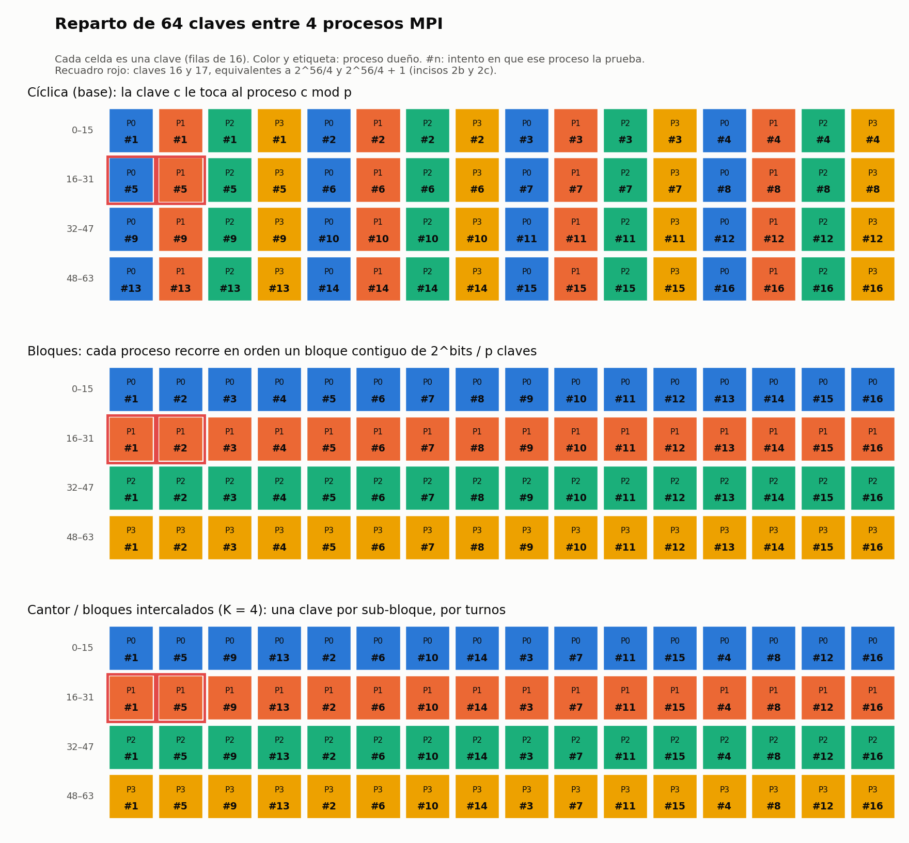
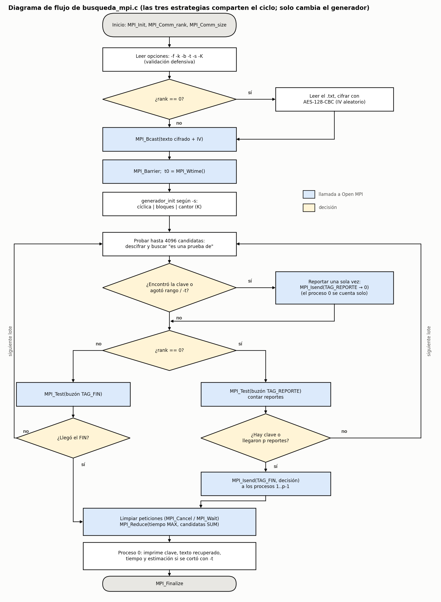
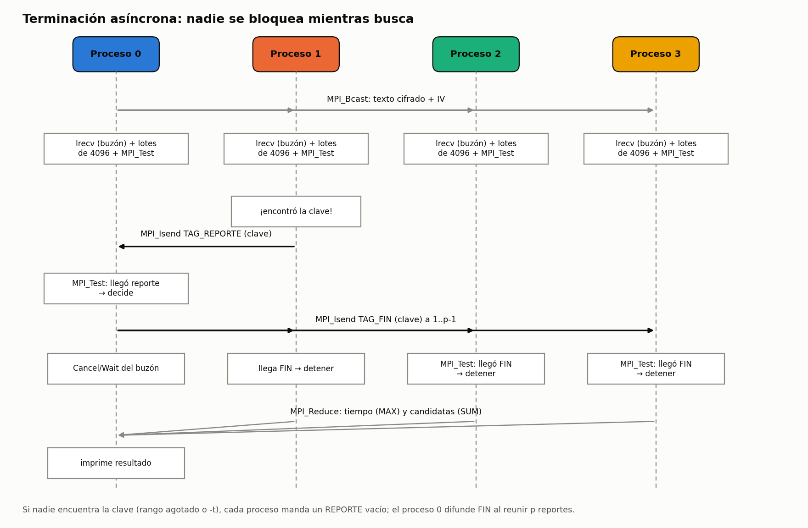

# Inciso 4. Funcionamiento de la estrategia alternativa

> Sección de Cindy. Diagramas en `diagrama/` (se regeneran con
> `python diagrama/generar_diagramas.py`).

## 4.1 Idea: bloques intercalados (dovetailing)

La estrategia base (cíclica) le da al proceso `r` las claves `r, r+p, r+2p, …`.
Todas las claves crecen al mismo ritmo en los cuatro procesos, así que el tiempo
para llegar a una clave `c` es proporcional a `c / p`: las claves pequeñas salen
rápido y las grandes, como 2^56/4, tardan años.

La alternativa parte el espacio de 2^56 claves en `p` **bloques contiguos** de
2^56/p claves (con 4 procesos, 2^54 cada uno) y divide cada bloque en `K`
**sub-bloques**. En lugar de agotar un sub-bloque antes de pasar al siguiente,
el proceso **avanza una clave en cada sub-bloque por turnos**. Si el bloque se
ve como una matriz de `K` filas, la estrategia de bloques simple la lee por
filas y el dovetailing la lee por columnas.

El nombre viene de la enumeración de Cantor: para recorrer infinitas listas sin
quedarse atrapado en la primera se avanza un paso en cada una por turnos. Con un
número finito de sub-bloques ese recorrido diagonal se reduce a un turno
rotativo. En el programa se selecciona con `-s cantor -K <sub-bloques>`;
`-s bloques` es el caso `K = 1`.



*Figura 1. Reparto de 64 claves entre 4 procesos con las tres estrategias. En
cíclica las claves 16 y 17 (equivalentes a 2^56/4 y 2^56/4 + 1) se prueban en
el intento 5; con bloques y con dovetailing, en los intentos 1 y 2 (bloques) o
1 y 5 (K = 4).*

**Ninguna clave se repite ni se omite.** Para el bloque del proceso `r`, el
intento `t` (desde 0) corresponde a la fila `j = t mod K` y la columna
`i = t div K`, y la clave es `inicio_r + inicio_sub(j) + i`. Por la división
euclidiana cada `t` da una única pareja `(i, j)` y viceversa, así que el
recorrido es una biyección sobre el bloque. Cuando `2^bits` no se divide entre
`p` (por ejemplo con 3 procesos) los primeros bloques reciben una clave extra, y
lo mismo pasa con los sub-bloques; las filas cortas solo se saltan en la última
columna. Esto se verificó con un arnés que recorre todas las claves para 1 a 9
procesos, rangos de 2 a 2048 claves y K de 1 a 5000.

**Posición de una clave.** La misma cuenta, al revés, dice qué proceso prueba
una clave `c` y en qué intento (`posicion_clave()` en `busqueda_mpi.c`). Con
4 procesos y 2^56 claves:

| Clave | Cíclica | Bloques (K = 1) | Cantor K = 16 | Cantor K = 256 |
|---|---|---|---|---|
| a) 123456 | P0, intento 30 865 | P0, 123 457 | P0, 1 975 297 | P0, 31 604 737 |
| b) 2^54 | P0, 4.5 × 10^15 | P1, **1** | P1, **1** | P1, **1** |
| c) 2^54 + 1 | P1, 4.5 × 10^15 | P1, **2** | P1, **17** | P1, **257** |
| 3·2^50 + 5 | P1, 8.4 × 10^14 | P0, 3.4 × 10^15 | P0, **84** | P0, **1 329** |
| 2^54 − 1 | P3, 4.5 × 10^15 | P0, 1.8 × 10^16 | P0, 1.8 × 10^16 | P0, 1.8 × 10^16 |

El programa solo usa esta posición para **estimar** el tiempo cuando una
búsqueda se corta con `-t`; la búsqueda en sí no conoce la clave.

## 4.2 Pseudocódigo

```text
programa busqueda_mpi(archivo, clave, bits, limite, estrategia, K):
    MPI_Init; rank, p ← MPI_Comm_rank, MPI_Comm_size
    leer y validar opciones                          // programación defensiva
    si rank = 0:
        texto ← leer_archivo(archivo)                // .txt, no vacío, ≤ 4096 B
        cifrado, iv ← AES-128-CBC(make_key(clave), texto)
    MPI_Bcast(cifrado, iv)
    MPI_Barrier; t0 ← MPI_Wtime

    total ← 2^bits
    según estrategia:                                // generador_init
        cíclica:  siguiente(n) = rank + n·p
        bloques:  inicio ← parte(total, p, rank); largo ← tamaño del bloque
                  K ← 1
        cantor:   igual que bloques, con K ← min(K, largo)

    // generador_siguiente para bloques / cantor
    función siguiente():
        repetir mientras columna < columnas:
            (fila, col) ← (fila_actual, columna_actual)
            avanzar fila; si fila = K: fila ← 0, columna ← columna + 1
            si col < tamaño del sub-bloque fila:
                devolver inicio + inicio_sub(fila) + col
        devolver AGOTADO

    buzón ← MPI_Irecv(TAG_REPORTE si rank = 0, TAG_FIN si no)
    mientras no detener:
        repetir 4096 veces:                          // un lote
            c ← siguiente(); si AGOTADO: agotado ← verdadero; salir
            si descifrar(c) contiene "es una prueba de":
                encontrada ← c; salir
        si limite y MPI_Wtime − t0 ≥ limite: agotado ← verdadero

        si (encontrada o agotado) y no reportado:
            reportado ← verdadero
            si rank = 0: contar el propio reporte
            si no: MPI_Isend(encontrada, a 0, TAG_REPORTE)

        si rank = 0:
            si MPI_Test(buzón): contar reporte; si trae clave, guardarla
                                volver a abrir el buzón con MPI_Irecv
            si hay clave o reportes = p:
                MPI_Isend(decisión, a 1..p−1, TAG_FIN); detener
        si no:
            si MPI_Test(buzón): decisión ← mensaje; detener

    limpiar: rank 0 cancela su buzón (MPI_Cancel + MPI_Wait) y espera sus envíos
    MPI_Reduce(tiempo, MAX); MPI_Reduce(candidatas, SUM)
    si rank = 0: imprimir clave, texto recuperado, tiempo y, si se cortó, estimación
    MPI_Finalize
```

## 4.3 Diagrama de flujo

Las tres estrategias comparten el mismo ciclo; solo cambia el generador que
entrega la siguiente candidata.



*Figura 2. Flujo de `busqueda_mpi.c`. En azul, las llamadas a Open MPI.*

## 4.4 Comunicación cuando se encuentra la clave

La versión base usaba `MPI_Allreduce` cada lote: los cuatro procesos tenían que
detenerse a sincronizar aunque nadie hubiera encontrado nada. La versión nueva
es **asíncrona**:

1. El proceso 0 cifra el mensaje y lo difunde con `MPI_Bcast`.
2. Cada proceso abre un buzón no bloqueante con `MPI_Irecv`: el 0 escucha
   reportes (`TAG_REPORTE`, cualquier origen) y los demás escuchan el aviso de
   fin (`TAG_FIN`, desde el 0).
3. Cada proceso prueba lotes de 4096 candidatas y entre lote y lote revisa su
   buzón con `MPI_Test`, que nunca bloquea.
4. El que encuentra la clave (o agota su bloque o el límite `-t`) manda **un
   solo** reporte al 0 con `MPI_Isend`.
5. El 0 decide en cuanto llega una clave, o cuando reunió los `p` reportes si
   nadie la encontró, y manda `TAG_FIN` con la decisión a todos.
6. Al terminar, el 0 cancela su buzón pendiente (`MPI_Cancel` + `MPI_Wait`) y
   todos esperan sus envíos antes de `MPI_Reduce` y `MPI_Finalize`.



*Figura 3. Mensajes cuando el proceso 1 encuentra la clave.*

El costo de enterarse es como máximo un lote del proceso 0 (4096 claves, del
orden de 1 ms). Por eso las búsquedas b) y c) con bloques terminan en ~2 ms
aunque la clave se pruebe en el primer o segundo intento.
